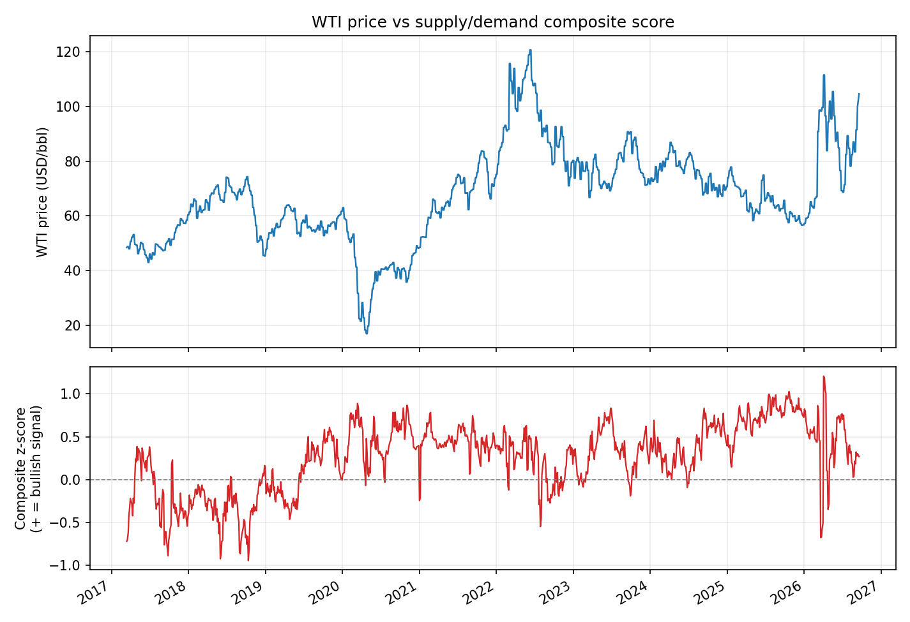

# WTI Crude Oil: Supply/Demand Scorecard + Positioning

A fundamentals-and-positioning scorecard for WTI crude oil, tested for
genuine out-of-sample explanatory power rather than presented as a working
model by default.

## Why this project

Built as a technical showcase for macro/commodities roles. "Scorecard"
models (combine a handful of fundamental indicators into one composite
signal) are common in commodities research. The point of this project is
to actually test whether a simple, transparent version of one holds up
out-of-sample, and to report what happens when it partially doesn't.

## Data (all public, no paid subscription or API key)

| Series | Source |
|---|---|
| WTI & Brent futures prices | Yahoo Finance (`CL=F`, `BZ=F`) |
| US commercial crude stocks ex-SPR, weekly | EIA |
| US weekly field production of crude oil | EIA |
| CFTC Disaggregated Commitments of Traders, WTI futures, Managed Money net position | CFTC (contract code 067651) |

Note: CFTC renamed this contract from "CRUDE OIL, LIGHT SWEET" to
"WTI-PHYSICAL" partway through 2022. `fetch_data.py` filters by the
CFTC contract code, not the name, to keep an unbroken history across
that rename.

## Method

1. **Four bullish-pressure indicators**, each an expanding z-score (using
   only data up to that date, no look-ahead), oriented so +1 = bullish
   for price:
   - **Inventory**: negative of stocks' deviation from their trailing
     5-year same-week seasonal average (low stocks vs season = bullish).
   - **Production**: negative of US crude production YoY growth (slowing
     or falling US supply = bullish).
   - **Positioning (contrarian)**: negative of Managed Money net long as
     % of open interest (an extremely crowded speculative long is read as
     bearish going forward, and vice versa).
   - **WTI-Brent spread**: WTI strengthening relative to Brent (tighter
     US-specific market = bullish for WTI specifically).
2. **Composite** = equal-weighted average of the four z-scores.
3. **Train/test split (70/30)**: the composite's correlation with forward
   4-week WTI returns is measured separately on train and test, so the
   headline number is genuinely out-of-sample.

## Results



| | n | correlation with fwd 4wk return | R2 | hit rate |
|---|---|---|---|---|
| Train | 692 | +0.003 | 0.000 | 56.9% |
| Test | 297 | **-0.134** | 0.018 | 47.8% |

Per-component correlation with forward returns (train / test):

| Indicator | Train corr | Test corr |
|---|---|---|
| Inventory | -0.089 | -0.135 |
| Production | +0.110 | +0.064 |
| Positioning (contrarian) | -0.100 | +0.053 |
| WTI-Brent spread | +0.031 | -0.237 |

## Interpretation

The equal-weighted composite has essentially zero explanatory power on
train (correlation +0.003) and a small **negative** one on test (-0.134,
hit rate below 50%). It does not currently work as a forecasting tool in
this simple form.

Two things stand out in the per-component breakdown:

- **Production** is the only indicator with a consistent sign across train
  and test (weakly positive both times) - the one piece of the scorecard
  with any stability, even though its effect size is small.
- **Inventory** has the theoretically "wrong" sign on both train and test:
  low stocks vs season are empirically associated with *lower*, not higher,
  forward returns in this sample. That's a genuine, counter-intuitive
  finding worth taking seriously rather than silently re-signing the
  indicator to make the composite look better - it may reflect reverse
  causality (demand weakness driving both low prices and low stock draws)
  or a regime-specific effect rather than the textbook storage-economics
  story.
- **WTI-Brent spread** flips sign and becomes strongly negative on test
  (-0.237), which is the single biggest driver of the composite's poor
  out-of-sample showing.

## Current reading (informational, not a validated signal)

As of the most recent week in the sample, the composite score is **+0.27**
(mildly bullish), driven mainly by an extreme contrarian positioning
reading (Managed Money net long near a multi-year low as a share of open
interest, z = +0.94) and modestly bullish production (+0.16). Given the
backtest above, this reading should be treated as a description of current
conditions, not a validated forecast.

## Limitations

- **Expanding z-scores can drift.** The composite stays positive for most
  of 2019-2026 in the chart, which suggests structural drift (e.g. the
  WTI-Brent spread's regime shift as US shale export capacity grew) rather
  than a genuinely mean-reverting indicator. A rolling (not expanding)
  window, or explicit detrending, would be a more honest normalization.
- **CFTC positioning history only starts January 2015** (bulk files don't
  go further back in this format), limiting how many regimes the backtest
  has seen - notably, no data before the 2014-16 oil crash.
- **Equal weighting is a simplifying choice**, not a fitted one - by
  design, to avoid tuning weights on the same data used to evaluate the
  composite. A weighted or regularized combination might do better, but
  would need its own honest out-of-sample test.
- **Weekly data, 4-week forward horizon**: results could differ materially
  at other horizons (e.g. 1-week momentum vs 12-week fundamentals).

## Next iteration

Test each indicator's horizon sensitivity separately (some fundamentals
may lead price by more or less than 4 weeks), and replace the expanding
z-score with a rolling one to check whether the apparent drift in the
composite is a normalization artifact or a real feature of the data.

## Usage

```bash
pip install -r requirements.txt
python fetch_data.py       # downloads CFTC + EIA raw data into rawdata/
python oil_scorecard.py     # builds the panel and the train/test stats
python plot_oil_scorecard.py
```

## Stack

Python, pandas, numpy, yfinance, matplotlib, xlrd (for EIA .xls files).
